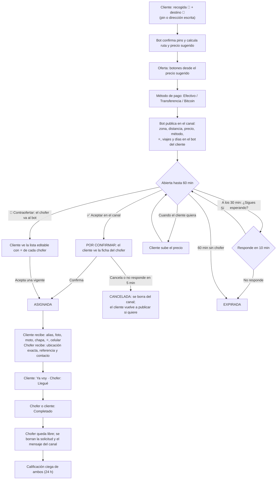
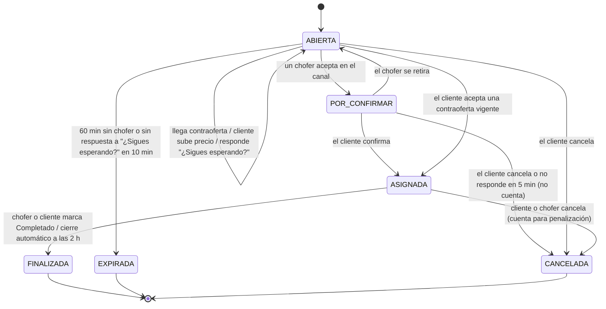
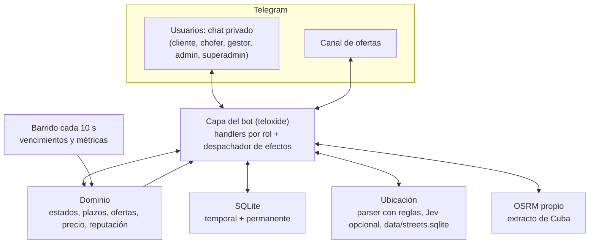

# Asere Voy — Moto-taxi por Telegram (subasta tipo inDrive) — Documento de diseño

Oct 14, 2026 · @Forte · Revisión 4

> **Estado de la revisión:** todas las secciones están revisadas. Ver [Registro de decisiones](#registro-de-decisiones) y [Preguntas abiertas](#preguntas-abiertas).

## Nombre

| | |
| --- | --- |
| **Nombre visible** | Asere Voy |
| **Usuario de Telegram** | `@AsereVoyBot` (`t.me/AsereVoyBot`) |
| **Descripción** | Conectamos pasajeros y choferes. Tú propones el precio. |

El 14 de octubre de 2026, `@AsereVoyBot` no tenía página pública en Telegram, lo que indica que probablemente está libre. Hay que reservarlo en BotFather cuanto antes; la confirmación definitiva es crearlo allí.

## Visión

Asere Voy es un bot de Telegram que conecta clientes y choferes de moto-taxi en una zona piloto de Cuba mediante una subasta de precio al estilo inDrive. No se guarda historial de viajes: de cada persona solo se conserva su reputación agregada (viajes, estrellas, cancelaciones). El pago es en CUP, directo al chofer.

Principios de diseño:

- El cliente propone el precio a partir de un precio sugerido por distancia; el chofer acepta o contraoferta.
- Todo corre en Telegram: un solo bot con roles (cliente, chofer, admin, superadmin; gestor en la versión 2) y un canal de ofertas para los choferes. WhatsApp está descartado.
- El estado de los viajes es temporal: cada solicitud vive en SQLite mientras está activa y se borra al cerrarse.
- Datos mínimos: se guardan de forma permanente el registro de choferes, la reputación agregada, los bloqueos, las cancelaciones recientes y las tarifas. Nunca rutas ni historial de viajes.
- El bot no maneja dinero ni datos bancarios. El pago (efectivo, transferencia o Bitcoin) se arregla entre cliente y chofer.
- La lógica de viajes no depende de Telegram: devuelve efectos que la capa del bot ejecuta.

**Supuesto del piloto.** La zona es lo bastante pequeña para que cualquier chofer llegue en pocos minutos; por eso gana el primero que acepta y no se usa la ubicación del chofer. Si la zona crece, habrá que añadir ubicación del chofer o dejar que el cliente elija entre varios.

## Actores y canales

Hay un solo bot. Lo que cada persona ve depende de su rol, y el rol se comprueba en el servidor en cada acción: ocultar un botón no es una medida de seguridad.

| Rol | Cómo se obtiene | Qué hace | Qué se guarda |
| --- | --- | --- | --- |
| Cliente | Cualquiera que abra el bot (`t.me/AsereVoyBot` o QR), acepte los términos y pulse Iniciar | Pide viaje, ofrece precio, elige método de pago, acepta o rechaza contraofertas, marca Ya voy y Completado, califica | Su reputación agregada y la fecha de su primer uso; su ID y su teléfono (opcional) mientras dura una solicitud |
| Chofer | Aplica desde el bot o un admin lo invita; un admin lo aprueba | Además de lo anterior: ve ofertas en el canal, acepta o contraoferta, marca Llegué y Completado, califica al cliente | Registro permanente: alias, celular, chapa, moto, fotos, estado; reputación agregada |
| Gestor *(versión 2)* | Aplica desde el bot o un admin lo invita; un admin lo aprueba | Además de lo que hace un cliente: pide viajes para sus propios clientes, con su propio precio, y puede tener varias solicitudes abiertas (ver [Gestores](#gestores)) | Registro permanente: alias, celular, estado; reputación agregada |
| Admin | Un superadmin lo nombra y puede quitarlo en cualquier momento | Además de lo anterior: aprueba, invita o quita choferes y gestores, bloquea usuarios, atiende el soporte y recibe alertas | Su ID; quién hizo cada acción administrativa |
| Superadmin | Definido en `.env`; no se añade ni se quita desde el bot | Además de lo anterior: nombra y quita admins, quita choferes y gestores en cualquier momento, ajusta tarifas | Su ID (en `.env`) |

**Alta de choferes y gestores.** Hay dos caminos:

- **Aplicar desde el bot:** en el menú de cualquier usuario están los botones **"Aplicar a ser chofer"** y, en la versión 2, **"Aplicar a ser gestor"**. La persona completa su ficha y los admins reciben la solicitud con los botones Aprobar y Rechazar.
- **Invitación de un admin:** el admin pulsa "Invitar chofer" (o "Añadir gestor" en la v2) y recibe un **enlace de invitación de un solo uso** (`t.me/AsereVoyBot?start=inv_X7K2`), que le pasa a la persona. Es la única forma de invitar (decisión 65). La persona abre el enlace y completa su ficha.

En los dos casos:

1. **La ficha del chofer** lleva alias, celular, chapa, modelo y color de la moto, **foto suya** (obligatoria), **foto de la moto** (opcional). El chofer no declara qué pagos acepta: lo decide oferta a oferta en el canal. **La del gestor** lleva alias y celular. Cada uno puede editar su ficha cuando quiera desde su perfil, sin volver a pasar por aprobación.
2. Un admin aprueba la ficha y la persona pasa a `activo`.
3. Si es chofer, el bot le envía el enlace del canal y aprueba su solicitud de unión.

**Por qué no WhatsApp.** La Cloud API cobra por los mensajes que inicia el negocio, y avisar a los choferes de cada viaje entra en esa categoría. Además exige una cuenta de Meta Business verificada, que probablemente no se pueda obtener desde Cuba por las sanciones de EE. UU. Telegram no cobra y permite todo el flujo. Por eso, validar que los clientes del piloto usan Telegram es requisito para seguir adelante con el proyecto.

**Canal de ofertas.**

- Es un **canal** (no un grupo): los choferes ven todas las ofertas en un feed separado de su chat personal y no pueden escribir en él.
- Se entra con un enlace de **solicitud de unión**; el bot solo aprueba a choferes `activo`.
- Pertenecer al canal **no** cuenta como verificación: en cada pulsación el bot comprueba que el chofer esté `activo` y no ocupado.
- Al bloquear a un chofer, el bot lo expulsa del canal (`banChatMember`).
- El bot es administrador del canal para publicar, editar y borrar ofertas.
- Cada oferta tiene dos botones:
  - **✅ Aceptar**: un callback; el primero gana y a los demás les sale "Ya fue tomado".
  - **💬 Contraofertar**: un botón con enlace al bot (`t.me/AsereVoyBot?start=co_AB12`) que abre el chat privado con los botones de monto.
- Al cerrar, cancelar o expirar una solicitud, su mensaje se **borra** del canal para que no quede historial.
- Un chofer que no trabaja simplemente silencia el canal. Mientras tiene un viaje asignado, el bot lo marca ocupado y no le deja aceptar otro.

**Soporte.** Todos los usuarios tienen un botón **💬 Soporte** en el menú.

- Sirve para quejas, accidentes, robos, cobros abusivos o problemas entre chofer y gestor, y sustituye a `/reportar`. La persona puede indicar el ID corto de un viaje.
- **Mecanismo:** una cuenta de Telegram atendida por personas (`SUPPORT_USERNAME`). El botón 💬 Soporte abre el chat con ella y muestra un **código de soporte** de 4 caracteres (renovado cada 30 días), que la persona incluye en su mensaje.
  - Con el código, un admin escribe `/caso K7P2` en el bot y ve el rol, la reputación y los bloqueos de esa persona, con los botones Bloquear 24 h, Bloquear, Desbloquear y Quitar chofer. Nadie necesita su ID de Telegram.
  - La cuenta de soporte tiene activado el **borrado automático** de mensajes para los chats nuevos (por ejemplo, a 1 semana), y la usa una sola persona en el piloto; si cambia, se cierran sus sesiones.
  - Al escribir a soporte, la cuenta ve el perfil de Telegram de la persona; los términos lo dicen.
  - Las **alertas automáticas** llegan a cada superadmin y admin en su chat con el bot, en su idioma y con sus botones.

**Alertas automáticas** (bloqueos temporales, reputación baja, cancelaciones por inseguridad, solicitudes de alta): llegan por privado a cada admin en su chat con el bot (decisión 60). Cada acción administrativa guarda quién la hizo (`añadido_por`, `confirmado_por`, `bloqueado_por`).

**Una persona con varios roles.** Un chofer puede pedir viajes como cliente desde el mismo chat, pero el bot le impide aceptar su propia solicitud. Lo mismo vale para un chofer que también sea gestor.

## Gestores

> **Versión 2.** Los gestores quedan fuera del MVP. Esta sección guarda el diseño para cuando se implementen. El MVP debe dejar preparado el modelo de datos (por ejemplo, que una solicitud pueda tener un `precio_cliente` vacío), pero no la funcionalidad.

Un gestor tiene su propio grupo de clientes y usa el bot para conectarlos con choferes, poniendo su propio precio. Su beneficio es la diferencia entre lo que paga el cliente y lo que cobra el chofer.

**Cómo funciona una solicitud de gestor:**

1. El gestor crea la solicitud en nombre de su cliente:
   - recogida y destino, igual que un cliente;
   - **contacto del cliente final** (nombre y teléfono), obligatorio, porque ese cliente no usa el bot;
   - **dos precios**: el **precio para el chofer**, que es el que se publica y se subasta, y el **precio para el cliente**, que es lo que paga el cliente y nunca puede ser menor que el del chofer.
2. En el canal, la oferta aparece marcada **🧑‍💼 Vía gestor**, con la reputación del gestor, el precio para el chofer, lo que el cliente paga y la **comisión** que el chofer deberá entregar al gestor.
3. Las contraofertas y las subidas de precio afectan al precio para el chofer. El gestor decide si mantiene el precio para el cliente (y reduce su comisión) o lo cambia.
4. Al asignar:
   - el chofer recibe el contacto del cliente final y el del gestor, cuánto cobrar al cliente y cuánto entregar al gestor;
   - el gestor recibe los datos del chofer.

   Ese mensaje queda en el chat de cada uno como constancia; el servidor no guarda historial.
5. El gestor puede marcar Ya voy y Completado en nombre de su cliente. El chofer califica al gestor.

**Reglas:**

- El gestor puede tener **varias solicitudes abiertas** a la vez.
- **El pago de la comisión se hace directamente del chofer al gestor.** El bot no interviene ni asume responsabilidad; los términos del gestor y del chofer lo dicen expresamente. Si hay un problema, cualquiera de los dos puede escribir a soporte.
- El precio mínimo se aplica al precio para el chofer.
- Las cancelaciones de las solicitudes de un gestor cuentan para el gestor.

## Ubicación y precio

La recogida y el destino pueden llegar como pin de ubicación o como dirección escrita. La IA solo interpreta el texto; las coordenadas, la ruta y el precio salen de herramientas que calculan.

| Paso | Qué ocurre | Herramienta |
| --- | --- | --- |
| 1 | El cliente manda un pin (puede elegir cualquier punto del mapa) y se pasa directo al paso 4 | Telegram |
| 2 | Si escribe una dirección, se extraen campos: `{calle, numero, entre: [A, B], reparto, municipio, referencia}`. Las reglas proponen candidatos (calles, repartos y lugares conocidos de `data/streets.sqlite` parecidos al texto) y Jev elige entre ellos | Parser con reglas; si está activado, Jev (TypeSafe) con preguntas Choice y confianza |
| 3 | Los campos se convierten en coordenadas. "Calle X entre A y B" se resuelve con el tramo de la calle X entre sus cruces con A y B. Se usa también una lista propia de lugares de referencia | `data/streets.sqlite`, generado a partir del extracto de OpenStreetMap de Cuba |
| 4 | Confirmación obligatoria: el bot devuelve el pin con "¿Es aquí?" y los botones [Sí] o [Corregir: enviar ubicación] | Telegram |
| 5 | Ruta: km y minutos | OSRM propio (Docker, `cuba-latest.osm.pbf`) |
| 6 | Precio sugerido = `base + tarifa_km × km`, redondeado a 10 CUP. Precio mínimo = `% mínimo` del sugerido | Fórmula |

- El texto de referencia ("frente a la bodega") se conserva y se le muestra al chofer, porque en Cuba las direcciones son informales.
- Si no se entiende la dirección, el bot pide: "No entendí la dirección, envía tu ubicación 📍".
- **Descripción libre como último recurso (fase 4).** Si la dirección no se entiende y el cliente no quiere o no puede mandar un pin, se acepta su descripción tal cual ("la casa azul detrás del policlínico"):
  - el cliente elige su **municipio con botones** (los 15 de La Habana) y después su **reparto**: con botones por páginas (12 por página, en todos los municipios) o escribiéndolo ("Alamar zona 6"). Si la descripción ya nombra un reparto, se usa directamente (decisión 67);
  - el **contacto es obligatorio** (@usuario o teléfono), porque el chofer seguramente tendrá que llamar para orientarse;
  - el canal lo marca: "📝 Dirección escrita, sin ubicación exacta";
  - la descripción es tan sensible como un pin: no va al canal ni a los logs, y el chofer la recibe solo cuando el cliente lo confirma.
- **Distancia aproximada (fase 4).** Si uno de los dos puntos (o los dos) no tiene coordenadas exactas, se usa el punto de su reparto (un municipio es demasiado grande: Habana del Este mide más de 30 km), se calcula la ruta con OSRM y se usa tal cual, sin margen: el error es de uno o dos km, y la subasta (los botones del cliente, las contraofertas) corrige el precio (decisión 69). El canal muestra la distancia como aproximada ("≈10 km").
- **Jev (TypeSafe) para interpretar direcciones, opcional** (se activa con un interruptor de configuración):
  - **Cómo se usa.** Jev no genera texto: elige entre opciones (`Choice`), puntúa o responde sí/no, y devuelve una **confianza**. Su propia documentación recomienda el patrón que usamos: las reglas encuentran candidatos y Jev elige cuál es el correcto, con una opción "ninguna".
    - Con confianza alta, se geocodifica.
    - Con confianza baja, el bot pide el pin.
    - En los dos casos sigue la confirmación del paso 4.
  - **API:** HTTP (`POST https://api.typesafe.ai/v1/systemone`, con token Bearer), llamable desde Rust con `reqwest`. Hay SDK oficial solo para Python y JavaScript.
  - **Costo:** se cobra solo la entrada (0,042 USD por millón de tokens). Una dirección con sus candidatos son unos cientos de tokens, así que el costo es prácticamente nulo.
  - **Precauciones:**
    - el inglés es su idioma principal y el español "funciona, pero no igual de bien", así que hay que probarlo con direcciones cubanas reales y fijar el umbral de confianza;
    - tiende a favorecer la primera opción de un `Choice`, así que conviene variar el orden de los candidatos;
    - sus límites de uso cambian sin aviso.
  - La cuenta y el pago de Jev se gestionan fuera de Cuba, igual que el VPS.
  - **Sin Jev** (interruptor apagado, error o servicio caído), el sistema funciona con reglas y pin.
- No se usa el servidor público de demostración de OSRM, cuya política no permite usarlo en producción.
- **Tarifas configurables:** `base`, `tarifa_km` y `% mínimo` se guardan en SQLite y los superadmins las cambian desde el bot (por ejemplo `/tarifa km 60`), para ajustarlas a la inflación sin tocar el código. Los valores iniciales vienen de `.env` y se copian a la tabla `tarifas` la primera vez que arranca el bot.
- **`tarifa_km` fija** (decisión 62): un precio por km que empieza con el valor de `.env` y los superadmins cambian con `/tarifa km <valor>` (también `/tarifa base` y `/tarifa minimo`; `/tarifas` muestra los valores). No hay modo combustible ni tasa de elTOQUE.

  En `metricas_diarias` se registra la relación precio final / precio sugerido, que sirve para ajustar la tarifa.
- La zona aproximada que se muestra en el canal es el **municipio** de La Habana donde cae cada pin ("📍 Plaza de la Revolución → Centro Habana"); si el pin está fuera de todos, no se muestra zona. Los contornos están en `data/zones.geojson`, generado una vez con `scripts/prepare_zones.py` (osmium + shapely) a partir de `cuba-latest.osm.pbf`: municipios (`admin_level=6`) dentro de la provincia (`admin_level=4`), simplificados. El bot calcula el municipio con point-in-polygon (crate `geo`). En los pins que recibe el chofer, la dirección es también el municipio.
- **Detalle a nivel de esquina en el canal (fase 4).** Con `data/streets.sqlite`, junto al municipio se muestra la esquina más cercana al pin, o la que interpretaron las reglas si la dirección es escrita: "📍 Plaza (23 y L) → Habana del Este (Alamar, calle 4 y 5)". Nunca enlaces de ubicación ni la dirección completa en el canal: el enlace sería el punto exacto donde una persona espera, a la vista de todos los choferes y fácil de capturar. Los pins y la dirección completa le llegan al chofer cuando el cliente lo confirma.

## Flujo de la subasta



Reglas del flujo:

- **La solicitud vive hasta 60 minutos** en el canal, sin rondas. El mensaje no se vuelve a publicar arriba. El cliente puede subir el precio o cancelar en cualquier momento; al subir el precio se edita el mismo mensaje del canal. Hay que limitar la frecuencia de edición (Telegram permite unos 20 mensajes por minuto en un chat).
- **"¿Sigues esperando?"** a los 30 minutos, con los botones Sí, Subir precio y Cancelar. Si el cliente no responde en 10 minutos, la solicitud expira. Así no quedan solicitudes abandonadas en el canal.
- **Confirmación del cliente:** cuando un chofer pulsa Aceptar en el canal, la solicitud queda reservada para él (POR CONFIRMAR) y el cliente recibe su ficha (foto, moto, chapa y, desde la fase 3, estrellas y viajes) con los botones Confirmar y Cancelar. Tiene 5 minutos.
  - Si confirma, se asigna y se intercambian los contactos. El chofer no recibe la ubicación exacta ni el contacto del cliente hasta ese momento.
  - Si cancela o no responde a tiempo, la solicitud se cancela: se borra del canal, se avisa al chofer y el cliente tiene que volver a publicar. No cuenta como cancelación del cliente, porque el viaje no estaba asignado.
  - Mientras espera la confirmación, el chofer cuenta como ocupado y no puede aceptar otra solicitud. Puede pulsar **Retirarme**: la solicitud vuelve a ABIERTA, reaparece en el canal con sus botones y se avisa al cliente.
  - Si los 60 minutos se cumplen durante una confirmación, se espera a que termine.
  - Aceptar una contraoferta no necesita este paso: el cliente ya eligió al chofer.
- **Oferta inicial** con botones sugeridos, por ejemplo `[sugerido] [+50] [+100]`; no se permite bajar del precio mínimo.
- **Método de pago:** Efectivo (por defecto), Transferencia (Transfermóvil, EnZona) o Bitcoin, un botón debajo del otro. Se muestra en el canal para que solo acepte quien pueda cobrarlo. Los datos para transferir (cuenta o dirección de Bitcoin) los da el chofer al cliente; no pasan por el bot.
- **@usuario obligatorio:** clientes y choferes necesitan un nombre de usuario de Telegram para usar el bot. Si no lo tienen, el bot explica cómo ponerlo (Ajustes → Nombre de usuario) y ofrece "Ya lo puse". Se comprueba en cada acción, porque se puede quitar. Así chofer y cliente siempre pueden escribirse o llamarse por Telegram, y **no se pide ni se guarda el teléfono del cliente**. El @usuario se consulta a Telegram al asignar el viaje; no se guarda.
- **Contraoferta:** en el chat privado con el bot, con botones de monto (+50, +100, +150 CUP). Vence en 5 minutos. No hay límite de contraofertas: si el cliente rechaza una, el chofer puede hacer otra. La nueva contraoferta de un chofer reemplaza a la anterior en la lista.
- **Lluvia de contraofertas:** cada contraoferta le llega al cliente como un mensaje propio, con la foto, la moto y (desde la fase 3) la reputación del chofer, y los botones Aceptar y Rechazar. El mensaje se borra solo cuando la contraoferta vence, se rechaza o se reemplaza por otra del mismo chofer, y todos se borran al asignar o cerrar la solicitud. Al aceptar, el bot comprueba que siga vigente y, si no, avisa.
- **Si el cliente sube el precio** por encima de una contraoferta, esa contraoferta se retira y se avisa al chofer de que puede aceptar el nuevo precio en el canal.
- **Reserva atómica:** el primer chofer que acepta se queda la solicitud mientras el cliente confirma (ver [Datos](#datos)).
- **Conexión:** al asignar, el cliente recibe los datos del chofer (incluido su celular) y el chofer recibe la ubicación exacta de la recogida y el destino (`sendVenue`, con título), la referencia y el contacto del cliente (@usuario y/o teléfono). El chat intermediado por el bot queda para más adelante.
- **Encuentro:** el cliente tiene el botón **Ya voy** y el chofer, **Llegué**. Cada uno avisa al otro y deja registrada la hora en la solicitud, que sirve para atribuir las cancelaciones.
- **Compartir viaje:** el cliente puede generar un texto con el alias, la moto, la chapa y la hora para reenviárselo a un familiar. No se guarda nada en el servidor.

## Estados de una solicitud



Hay seis estados. Una solicitud ABIERTA lleva su lista de contraofertas activas. Cada solicitud tiene un ID corto, el precio vigente, el método de pago, las contraofertas activas, el plazo de 60 minutos, la hora de la pregunta "¿Sigues esperando?" y, en POR CONFIRMAR, el chofer reservado y el plazo de 5 minutos.

Efectos al entrar en cada estado:

| Al entrar en… | El bot hace |
| --- | --- |
| POR CONFIRMAR | Marca al chofer como ocupado, edita el mensaje del canal a "En confirmación" (sin botones) y envía al cliente la ficha del chofer con Confirmar y Cancelar |
| ASIGNADA | Marca al chofer como ocupado, retira todas sus contraofertas en otras solicitudes, avisa a los choferes que contraofertaron en esta, edita el mensaje del canal a "Tomado" |
| FINALIZADA | Libera al chofer, borra el mensaje del canal, crea la calificación pendiente y elimina la solicitud |
| CANCELADA | Lo mismo que FINALIZADA (sin calificación), más una cancelación registrada para el cliente cuando corresponde (ver [Datos](#datos)) |
| EXPIRADA | Borra el mensaje del canal y le ofrece al cliente "¿Publicar de nuevo?" |

**Si el chofer cancela un viaje asignado** no hay reasignación automática: el cliente recibe el botón "Republicar al mismo precio", que crea una solicitud nueva. Al principio no se penaliza a los choferes. Si cancela con el motivo "me sentí inseguro", se avisa a los admins.

## Reputación

Solo se guardan agregados por persona: nunca qué viaje hizo, con quién ni a dónde.

- **Se califica** solo tras un viaje FINALIZADO. Cliente y chofer reciben botones de ⭐1 a ⭐5 y etiquetas fijas (*puntual, amable, cobró de más, no apareció*), opcionales, durante 24 h. No hay comentarios libres.
- **La calificación es ciega:** se guarda en una `calificacion_pendiente` temporal y solo se suma a los agregados cuando ambos calificaron o pasaron 24 h. Después se borra.
- **Contra viajes falsos:** se guarda una huella temporal del par cliente-chofer (HMAC con clave secreta, no un hash simple, porque los IDs de Telegram se pueden adivinar por fuerza bruta) que vence a los 7 días. Entre el mismo par solo cuenta una calificación por semana.
- **Qué se muestra:**
  - **del cliente**, en el mensaje del canal: estrellas, viajes completados y días usando el bot (⭐4.7 · 23 viajes · 120 días). Con menos de 5 viajes las estrellas se muestran como "Nuevo";
  - **del chofer**, en las contraofertas y en la asignación: estrellas y viajes completados.

  Los días usando el bot ayudan al chofer a distinguir una cuenta recién creada.
- **Una nota baja no bloquea automáticamente:** por ejemplo, un promedio por debajo de 3.5 con 10 viajes o más genera una alerta a los admins.

## Datos

Todo vive en un solo archivo SQLite. Lo temporal se borra al cerrar; lo permanente se limita a lo necesario para el control de acceso, la reputación y los precios. No hay Redis.

| Tabla | Tipo | Campos clave |
| --- | --- | --- |
| `choferes` | Permanente | `telegram_id`, alias, celular (cifrado), chapa, modelo y color de la moto, `file_id_foto_chofer`, `file_id_foto_moto` (opcional), estado (`pendiente`, `activo`, `bloqueado`), `fecha_alta`, `añadido_por`, `confirmado_por` |
| `admins` | Permanente | `telegram_id`, `nombrado_por`, fecha (los superadmins viven solo en `.env`) |
| `gestores` *(v2)* | Permanente | `telegram_id`, alias, celular (cifrado), estado (`pendiente`, `activo`, `bloqueado`), `fecha_alta`, `añadido_por`, `confirmado_por` |
| `invitaciones` | Temporal | código aleatorio (10 caracteres o más), `creado_por`, `vence_en` (48 h), usado |
| `reputacion` | Permanente, agregada | `telegram_id`, rol, `primer_uso`, viajes completados, suma y número de estrellas, conteo por etiqueta |
| `bloqueados` | Permanente | `telegram_id`, rol, motivo (texto corto), `hasta` (`NULL` = permanente), fecha, `bloqueado_por` |
| `cancelaciones` | Vence a los 30 días | `telegram_id`, rol, fecha |
| `tarifas` | Configuración | clave, valor |
| `solicitudes` | Temporal, se borra al cerrar | ID corto, `cliente_id` (o `gestor_id` en v2), teléfono de contacto (vacío en el MVP; en v2, obligatorio con el nombre del cliente final si es de gestor), recogida, destino, referencia, km, precio (para el chofer), `precio_cliente` (solo gestor, v2), método, estado, `chofer_id` (reservado o asignado), `msg_canal_id`, `asignada_en`, `pregunta_en` ("¿Sigues esperando?"), `confirmar_hasta`, `ya_voy_en`, `llego_en`, `vence_en` (60 min) |
| `contraofertas` | Temporal | `solicitud_id`, `chofer_id`, monto, `vence_en` |
| `calificaciones_pendientes` | Temporal, 24 h | `cliente_id`, `chofer_id`, notas y etiquetas de cada lado, `vence_en` |
| `pares_recientes` | Temporal, 7 días | HMAC del par cliente-chofer, `vence_en` |
| `user_prefs` | Permanente | `telegram_id`, idioma (`es` o `en`), solo si el usuario lo cambió |
| `metricas_diarias` | Agregada, sin IDs | fecha, solicitudes, asignadas, expiradas, canceladas, km promedio, precio promedio, relación precio final / sugerido |

Los contornos de los municipios (`data/zones.geojson`) y, más adelante, los lugares de referencia de la zona piloto son archivos de datos estáticos en el repositorio, no tablas.

**Asignación atómica.** Una sola sentencia decide el ganador:

```sql
UPDATE solicitudes SET estado = 'POR_CONFIRMAR', chofer_id = ?
WHERE id = ? AND estado = 'ABIERTA';
-- filas afectadas = 1 → ganó; 0 → "Ya fue tomado"
```

**Reglas de cancelación.**

- Solo cuentan las cancelaciones de viajes ya ASIGNADOS, y por ahora solo para clientes.
- Si el cliente cancela con el motivo "el chofer no llega" y pasaron 15 min sin "Llegué", la cancelación no cuenta para el cliente.
- Si el chofer pulsó "Llegué" y el cliente no aparece en 10 min, el chofer cancela con "el cliente no apareció" y la cancelación cuenta para el cliente.
- Con 3 cancelaciones en 7 días, el cliente recibe un bloqueo temporal de 24 h y se avisa a los admins.
- Cada registro vence a los 30 días.

**Privacidad y protección.**

- `PRAGMA secure_delete = ON`, para que lo borrado no quede recuperable dentro del archivo.
- **Logs sin contenido:** solo eventos e IDs cortos (`solicitud AB12 → ASIGNADA`); nunca coordenadas, direcciones ni teléfonos.
- El celular se cifra en reposo con una clave en `.env`. Esto protege las copias de seguridad y una filtración del archivo `.db`, no un acceso al servidor.
- Las copias de seguridad van cifradas.
- La foto no se almacena: Telegram entrega un `file_id` y con ese texto se reenvía cuando haga falta.
- No se guardan tarjetas ni datos bancarios.
- No se guardan teléfonos de clientes: el contacto es su @usuario, que se consulta a Telegram al asignar.
- Al chofer se le informa qué datos se guardan y para qué.

## Arquitectura técnica



**Lenguaje: Rust.** Se eligió por:

- desplegar un solo binario que usa poca RAM y corre en un VPS barato (fuera de Cuba);
- modelar la máquina de estados con `enum`, de modo que el compilador obliga a cubrir todos los casos.

El script que preprocesa OSM se ejecuta una sola vez fuera del bot y puede quedarse en Python.

**El dominio devuelve efectos.** La lógica de viajes no importa `teloxide`: recibe un comando y devuelve una lista de efectos que la capa del bot ejecuta. Así se puede probar sin Telegram.

```rust
// src/domain/request.rs (simplificado)
pub fn accept(&mut self, driver: UserId, now: UnixTime) -> Result<Vec<Effect>, DomainError> {
    // valida: Open, no vencida, no es su propia solicitud
    Ok(vec![
        Effect::MarkChannelTaken { request: id },
        Effect::Notify { to: self.client, notice: Notice::DriverAssigned { request: id, driver } },
        Effect::Notify { to: driver, notice: Notice::TripAssigned { request: id, client: self.client } },
        Effect::SendLocation { to: driver, point: self.pickup },
    ])
}
```

**Los vencimientos se resuelven con un barrido.** Cada 10 segundos una tarea revisa las filas con `vence_en < ahora` (plazo de 60 min, "¿Sigues esperando?", confirmación del cliente, contraofertas, cierre automático a las 2 h, calificaciones, bloqueos temporales, invitaciones) y actualiza `metricas_diarias`. No hay temporizadores en memoria, así que un reinicio no pierde nada.

**Límites de Telegram:**

- unos 20 mensajes por minuto en un mismo chat o canal, ediciones incluidas;
- unos 30 mensajes por segundo en total;
- `callback_data` admite como máximo 64 bytes, así que se usan IDs cortos (`acc:AB12`);
- solo una instancia puede hacer polling por token.

**Stack:**

- `teloxide` (con diálogos persistidos en SQLite) y `tokio`.
- `sqlx` con SQLite y migraciones.
- `reqwest` para OSRM, Jev y la API de elTOQUE.
- `tracing` para logs sin contenido.
- `serde`, `dotenvy`, `time`.
- `chacha20poly1305` (cifrado del celular) y `hmac` + `sha2` (huellas de pares).
- OSRM en Docker con `cuba-latest.osm.pbf` (Geofabrik).
- Jev (TypeSafe) opcional por HTTP, con la API key en `.env`. No hace falta un modelo local ni RAM extra en el servidor.
- El token y la configuración en `.env`; long polling, sin dominio ni webhook.


**Estructura del proyecto:**

```
aserevoy/
  Cargo.toml
  .env.example            # variables de configuración (el .env real no se sube)
  migrations/             # esquema SQLite
  docs/diseno.md          # este documento
  docs/docker.md          # arrancar con Docker, volúmenes, copias y actualizar el mapa
  Dockerfile, docker-compose.yml, docker/osrm-prepare.sh
  data/zones.geojson      # contornos de los municipios de La Habana (zona aproximada, ODbL)
  data/streets.sqlite     # calles, esquinas, repartos y lugares de La Habana (ODbL)
  data/README.md          # origen y atribución de los datos de OpenStreetMap
  scripts/prepare_osm.py  # genera streets.sqlite a partir del extracto de OSM
  scripts/prepare_zones.py # genera data/zones.geojson a partir del extracto de OSM
  src/
    main.rs               # arranca el bot y el barrido
    config.rs             # lectura del .env
    i18n.rs               # textos en español (por defecto) e inglés
    bot/                  # teloxide: dispatcher.rs, effects.rs, client.rs, trip.rs, auction.rs, driver.rs, rating.rs, admin.rs, support.rs
    domain/               # sin teloxide: request.rs, effect.rs, fare.rs, ids.rs, reputation.rs
    location/             # parser.rs, jev.rs, geocoder.rs, routing.rs
    db/                   # mod.rs (conexión y migraciones), requests.rs, fares.rs, …
    tasks/sweeper.rs
```

**Idioma del código y del bot.**

- **El código va en inglés:** nombres, tablas, columnas y comentarios (`requests`, `drivers`, `fares`, `State::Assigned`…). Este documento sigue en español, y las tablas que describe se llaman en el código por su nombre en inglés.
- **El bot es bilingüe: español por defecto e inglés.**
  - Todos los textos están en `src/i18n.rs` con `enum Lang { Es, En }`; cada texto es un `match` sobre el idioma, así que el compilador rechaza un mensaje sin traducción.
  - El dominio no produce textos, solo `Notice`, que el bot traduce al idioma de cada usuario.
  - El idioma inicial sale de `language_code` de Telegram: inglés si empieza por `en`, español en cualquier otro caso.
  - El usuario puede cambiarlo con un botón; esa preferencia es lo único que se guarda (`user_prefs`).

## Anti-abuso y seguridad

Sin historial de viajes, el control descansa en pocas reglas simples, la reputación y los admins. Al principio se limita lo menos posible: hay pocos choferes, todos comprobados, y algunos clientes pueden pedir viajes para otros (gestores).

**Para proteger al chofer**

- En el mensaje del canal, el chofer ve las **estrellas, los viajes completados y los días en el bot** del cliente, además de la zona, antes de aceptar. Así puede desconfiar de una cuenta recién creada que pide un viaje desde un lugar apartado.
- **Contacto por @usuario:** el chofer puede escribir o llamar al cliente por Telegram sin que el cliente dé su teléfono.
- **El chofer puede cancelar sin penalización**, por ejemplo con el motivo "me sentí inseguro", que avisa a los admins.
- **Evasión de bloqueos:** se acepta que un cliente bloqueado pueda volver con otra cuenta de Telegram. Mostrar los días en el bot y los viajes ayuda a que el chofer lo note.

**Para proteger al cliente**

- Los choferes salen de una **lista comprobada**: solo los añade un admin, idealmente después de verificarlos en persona.
- Al asignar, el cliente ve la foto, la moto, la chapa, las estrellas y el celular del chofer.
- **Compartir viaje:** un texto para reenviárselo a un familiar, sin guardar nada.
- **Ya voy / Llegué:** cada parte avisa a la otra, y las horas sirven para atribuir bien las cancelaciones.

**Reglas del mercado**

- **Precio mínimo** como porcentaje del precio sugerido, para que nadie hunda el mercado con ofertas absurdas.
- **Una solicitud abierta por cliente** a la vez; en la versión 2, los gestores podrán tener varias.
- **Un viaje asignado por chofer** a la vez; al asignarlo, sus otras contraofertas se retiran.
- **Contraofertas sin límite:** si el cliente rechaza una, el chofer puede hacer otra; la nueva reemplaza a la anterior.
- **No hay límite de solicitudes por hora** al principio.
- **Cancelaciones:** por ahora solo penalizan al cliente: 3 en 7 días (de viajes asignados) suponen un bloqueo temporal de 24 h.

**Seguridad del bot**

- **Roles verificados en el servidor en cada acción**, no por ver un botón ni por pertenecer al canal.
- **Anti-flood:** como máximo 1 acción por segundo por usuario; las pulsaciones de más se ignoran.
- **Dirección exacta y teléfono solo al asignar**; en el canal se muestra una zona aproximada.
- **Lista de bloqueados** por ID de Telegram, consultada antes de aceptar cualquier solicitud o acción; bloquear a un chofer lo expulsa del canal.
- **Jerarquía de administración:**
  - los superadmins están en `.env` y no se pueden quitar desde el bot;
  - pueden quitar en cualquier momento a cualquier admin o chofer;
  - cada acción administrativa queda registrada con quién la hizo.

  Si alguien roba la cuenta de Telegram de un admin, un superadmin lo quita.
- **Invitaciones** de un solo uso, con un código aleatorio de al menos 10 caracteres, que caducan a las 48 h.
- **Token del bot:** en `.env` con permisos `600`; si se filtra, se revoca en BotFather.
- **Protección de datos:** cifrado del celular del chofer, copias cifradas, `secure_delete`, logs sin contenido, acceso restringido al servidor y secretos en variables de entorno.

**Aspectos legales**

- **Términos y aviso de privacidad** que cada persona acepta la primera vez que inicia el bot. Deben decir que la plataforma solo conecta a cliente y chofer, que no es transportista ni asegura viajes, y qué datos se guardan.
- **Atribución de OpenStreetMap:** los contornos de los municipios y las rutas (OSRM) salen de datos de OpenStreetMap (licencia ODbL). Los términos del bot (fase 3) deben incluir "Datos del mapa © colaboradores de OpenStreetMap"; en el repositorio, la atribución está en `data/README.md`. El código es MIT, pero `data/zones.geojson` sigue bajo la ODbL.
- **Soporte** (quejas, accidentes, robos, cobros abusivos, problemas con la comisión de un gestor) con el botón 💬 Soporte; llega a los admins.
- **Comisión del gestor (v2):** el bot no interviene en el pago entre chofer y gestor ni asume responsabilidad; lo dicen los términos de ambos.

## Plan de MVP en local

El desarrollo va por fases; cada una deja algo que funciona de principio a fin. Las fases 1 a 4 se prueban en local con un bot y un canal de prueba y dos cuentas de Telegram, antes de tocar un servidor. No hay fase de validación previa: si los clientes usan Telegram se comprueba en el piloto.

| Fase | Contenido | Resultado |
| --- | --- | --- |
| **1. Núcleo** | Proyecto, migraciones de SQLite y superadmin desde `.env`. Alta de choferes por enlace de invitación y por "Aplicar a ser chofer", con ficha editable desde el bot. Solicitud solo con pin, OSRM y tarifa fija. Publicación en el canal y aceptación atómica. Intercambio de contacto. Completado, Cancelar y barrido | Un viaje real de principio a fin |
| **2. Subasta** | Solicitud abierta hasta 60 min con "¿Sigues esperando?" a los 30 min, confirmación del chofer por el cliente, subir el precio, Republicar, contraofertas con enlace al bot, lista editable con Aceptar y Rechazar | La experiencia tipo inDrive |
| **3. Confianza** | Ya voy y Llegué, cancelaciones del cliente según el motivo, bloqueos, reputación ciega (estrellas, viajes y días en el bot), botón 💬 Soporte, Compartir viaje, rol de admin, términos y aviso de privacidad, anti-flood | Listo para usuarios que no conoces |
| **4. Comodidad** | Direcciones escritas (reglas y `data/streets.sqlite`), descripción libre como último recurso situada en su reparto, con distancia aproximada, esquina más cercana en el canal, Jev para elegir entre candidatos (umbral 0,7), lugares de referencia de OSM, `metricas_diarias`, `/tarifa` | Menos fricción |
| **5. Piloto** | Una zona, pocos choferes de confianza, despliegue en producción, copias de seguridad cifradas diarias, alertas de error a los superadmins | Datos reales |
| **Versión 2** | Gestores: rol, "Aplicar a ser gestor", solicitudes con precio para el chofer y para el cliente, varias solicitudes abiertas, oferta marcada "Vía gestor" en el canal | Después de validar el piloto |

**Pruebas.**

- La lógica de dominio no depende de Telegram, así que la máquina de estados, los plazos, los precios y las cancelaciones se prueban con tests unitarios.
- La asignación atómica se prueba con un test que lanza N aceptaciones en paralelo y comprueba que hay exactamente un ganador.
- Las pruebas de integración usan un bot y un canal de prueba con su propio token.

**Antes del piloto hay que preparar (en el VPS fuera de Cuba):**

- las alertas de error a los superadmins (OSRM o la base de datos caídos);
- las copias de seguridad diarias, cifradas y fuera del servidor.

**Métricas de éxito del piloto (propuesta, por confirmar):**

- más del 60 % de las solicitudes se asignan;
- la asignación tarda de media menos de 5 min;
- menos del 10 % de los viajes asignados se cancelan;
- más del 30 % de los clientes repiten en el mes.

## Preguntas abiertas

Estas decisiones cambian el diseño y conviene cerrarlas antes de programar.

- [x] **¿Cómo se llama el bot?** → **Asere Voy** (`@AsereVoyBot`). Falta reservarlo en BotFather.
- [x] ¿Cuánto dura cada ronda? → Ya no hay rondas: la solicitud vive hasta 60 minutos y el cliente puede subir el precio en cualquier momento (decisión 49).
- [x] ¿Qué pasa si el cliente acepta una contraoferta que justo venció? → El bot comprueba que siga vigente y, si no, avisa. Al asignarse un chofer, sus contraofertas se retiran.
- [x] ¿Qué ocurre cuando un chofer cancela ya asignado? → Botón "Republicar al mismo precio"; sin reasignación automática y, al principio, sin penalizar al chofer.
- [x] ¿Puede una misma persona ser cliente y chofer? → Sí, en el mismo bot; no puede aceptar su propia solicitud.
- [x] ¿Cuánto tiempo se conserva el conteo de cancelaciones? → 30 días por registro; 3 en 7 días suponen un bloqueo de 24 h (solo clientes, por ahora).
- [x] ¿Cómo se verifica a un chofer antes de aprobarlo? → Lo añade un admin, idealmente con verificación en persona; el chofer completa su ficha y el admin la confirma.
- [x] ¿Conexión por @usuario y teléfono, o chat intermediado por el bot? → En el MVP, intercambio directo: el celular del chofer y el @usuario y/o teléfono opcional del cliente. El chat intermediado queda para más adelante.
- [ ] ¿Cómo se cobra el servicio: comisión por viaje, suscripción de choferes o gratis al inicio?
- [x] ¿Se permiten varias solicitudes abiertas para quien pide viajes para otros? → Sí, con el rol de gestor (ver [Gestores](#gestores)).
- [x] ¿El soporte funciona con un grupo privado de admins con un tema por usuario, o con mensajes privados a cada admin? → Ninguno de los dos: una cuenta de Telegram atendida por personas, con código de soporte (decisión 60).
- [ ] (v2) Gestores: ¿el chofer debe ver en el canal el precio para el cliente y la comisión, o solo su propio precio?
- [x] ¿Qué puede hacer exactamente un admin frente a un superadmin? → El admin gestiona choferes, bloqueos y reportes; el superadmin, además, gestiona admins y tarifas.
- [x] ¿Se añade `/emergencia` con los números de Cuba? → No por ahora.
- [ ] ¿Los clientes en la zona piloto realmente usan Telegram? **Decide si el proyecto sigue.** Se comprobará en el piloto, sin validación previa.
- [x] Si un chofer ya activo cambia su foto, chapa o moto, ¿vuelve a necesitar la confirmación de un admin? → No. Los choferes ya están comprobados y editan su ficha libremente.
- [x] ¿Qué tal funciona Jev con direcciones cubanas reales? ¿Qué umbral de confianza se usa? → Bien: 10 de 12 en una prueba con direcciones de La Habana, ~360 ms por consulta; umbral 0,7 (decisión 63).
- [ ] ¿El piloto es gratis? ¿Son razonables las métricas de éxito propuestas?
- [ ] ¿Qué se dice a los usuarios sobre privacidad, datos y reputación?
- [ ] ¿Valores iniciales de tarifa: `base`, `tarifa_km` y `% mínimo`? (Para calibrarlos, preguntar a los choferes del piloto cuánto cobran hoy por trayectos típicos.)
- [x] ¿Cuándo y cómo pasar `tarifa_km` del modo fijo al modo combustible? → No se pasa: tarifa fija editable por los superadmins (decisión 62).
- [x] ¿Cuánto espera el bot a que el cliente responda "¿subir oferta?" antes de expirar? → Pregunta "¿Sigues esperando?" a los 30 minutos y espera 10 (decisión 50).
- [x] ¿Cuáles son los lugares de referencia de la zona piloto? → Los lugares con nombre y los repartos de OpenStreetMap, en `data/streets.sqlite` (decisión 63).
- [x] ¿Dónde corre en producción? → En un VPS fuera de Cuba, pagado desde fuera.

## Registro de decisiones

| # | Decisión | Fecha |
| --- | --- | --- |
| 1 | Rondas y contraofertas de 5 min, máximo 3 rondas; `vence_en` se reinicia en cada ronda. *Las rondas quedan sustituidas por la decisión 49; las contraofertas siguen venciendo a los 5 min* | 2026-10-13 |
| 2 | WhatsApp descartado (costo por mensaje y probable bloqueo de la Cloud API en Cuba) | 2026-10-13 |
| 3 | Pago en CUP, método elegido por el cliente (efectivo o transferencia); sin datos bancarios en el bot | 2026-10-13 |
| 4 | Roles verificados en el servidor en cada acción; entrada al canal con solicitud de unión solo para choferes activos | 2026-10-13 |
| 5 | Sin botón de disponibilidad: el chofer silencia el canal si no trabaja; el bot lo marca ocupado mientras tiene viaje asignado | 2026-10-13 |
| 6 | Basta con que el chofer o el cliente marquen Completado; cierre automático a las 2 h | 2026-10-13 |
| 7 | Ubicación por pin o por texto: reglas (+ Jev opcional) → `data/streets.sqlite` → confirmación → OSRM propio → precio sugerido con tarifas configurables | 2026-10-13 |
| 8 | Las contraofertas se muestran al cliente en un único mensaje editable. *Sustituida por la decisión 53* | 2026-10-13 |
| 9 | Un solo bot con roles cliente, chofer, admin y superadmin | 2026-10-13 |
| 10 | Se elimina el estado NEGOCIANDO | 2026-10-13 |
| 11 | Si el chofer cancela, "Republicar al mismo precio" en lugar de reasignar | 2026-10-13 |
| 12 | Estado temporal en SQLite (sin Redis ni memoria), borrado al cerrar, `secure_delete` | 2026-10-13 |
| 13 | Vencimientos por barrido periódico sobre `vence_en` | 2026-10-13 |
| 14 | Métricas diarias agregadas, sin IDs | 2026-10-13 |
| 15 | Logs sin contenido: ni ubicaciones, ni direcciones, ni teléfonos | 2026-10-13 |
| 16 | Cancelaciones: vencen a los 30 días; 3 en 7 días suponen 24 h de bloqueo; solo cuentan los viajes asignados; por ahora solo para clientes | 2026-10-13 |
| 17 | La tabla de bloqueados lleva motivo, `hasta` y quién bloqueó | 2026-10-13 |
| 18 | El dominio devuelve efectos y la capa del bot los ejecuta | 2026-10-13 |
| 19 | Geocodificador propio a partir de OSM preprocesado, sin Nominatim | 2026-10-13 |
| 20 | Jev (TypeSafe) opcional para interpretar direcciones, activado con un interruptor; sustituye a Ollama | 2026-10-14 |
| 21 | Rust (`teloxide`, `tokio`, `sqlx`); el script de OSM puede quedarse en Python | 2026-10-13 |
| 22 | Superadmins solo en `.env`; nombran y quitan admins y pueden quitar choferes en cualquier momento; cada acción guarda quién la hizo | 2026-10-14 |
| 23 | Botón 💬 Soporte para todos los usuarios; los admins responden desde el bot. *Mecanismo fijado en la decisión 60* | 2026-10-14 |
| 24 | Reputación de nivel A (solo agregados), calificación ciega en ambas direcciones, sin historial de viajes | 2026-10-13 |
| 25 | Alta de choferes por selector de contactos o por enlace de invitación de un solo uso. *Sustituida por la decisión 65* | 2026-10-13 |
| 26 | Canal de ofertas con ✅ Aceptar (callback) y 💬 Contraofertar (enlace al bot) | 2026-10-13 |
| 27 | Tarifas: valores iniciales en `.env`, después editables desde el bot; `tarifa_km` en modo fijo para el MVP, con un modo basado en combustible por definir. *El modo combustible se descarta (decisión 62)* | 2026-10-13 |
| 28 | En el canal se muestran del cliente sus estrellas, viajes completados y días usando el bot | 2026-10-14 |
| 29 | El teléfono del cliente es opcional (escrito o con `request_contact`) y solo vive en la solicitud. *Sustituida por la decisión 61* | 2026-10-14 |
| 30 | El chofer puede cancelar sin penalización (motivo "inseguro" avisa a los admins); al principio no se penaliza a los choferes | 2026-10-14 |
| 31 | Botones Ya voy (cliente) y Llegué (chofer); las cancelaciones del cliente se atribuyen con esas horas | 2026-10-14 |
| 32 | Sin límite de solicitudes por hora ni de contraofertas; el cliente puede rechazar una contraoferta y el chofer hacer otra | 2026-10-14 |
| 33 | No se intenta impedir la evasión de bloqueos con cuentas nuevas | 2026-10-14 |
| 34 | Anti-flood de 1 acción por segundo por usuario | 2026-10-14 |
| 35 | Botón Compartir viaje; invitaciones de un solo uso con caducidad a las 48 h; token en `.env` con permisos `600`; términos y aviso de privacidad al iniciar | 2026-10-14 |
| 36 | Permisos: el admin gestiona choferes, bloqueos y reportes; el superadmin, además, admins y tarifas. Sin `/emergencia` por ahora | 2026-10-14 |
| 37 | Plan en 5 fases (núcleo, subasta, confianza, comodidad, piloto), sin fase de validación previa | 2026-10-14 |
| 38 | El chofer completa y edita su ficha desde el bot, sin volver a confirmación; foto suya obligatoria, foto de la moto opcional | 2026-10-14 |
| 39 | VPS y pagos de servicios (Jev, VPS) fuera de Cuba | 2026-10-14 |
| 40 | Botones "Aplicar a ser chofer" y "Aplicar a ser gestor"; un admin aprueba | 2026-10-14 |
| 41 | Versión 2 — Rol de gestor: crea solicitudes para sus clientes con precio para el chofer y precio para el cliente; varias solicitudes abiertas; el chofer paga la comisión directamente al gestor y el bot no asume responsabilidad | 2026-10-14 |
| 42 | Nombre del bot: Asere Voy (`@AsereVoyBot`), con la descripción "Conectamos pasajeros y choferes. Tú propones el precio." | 2026-10-14 |
| 43 | El código (nombres, tablas, comentarios) va en inglés; el documento de diseño sigue en español | 2026-10-14 |
| 44 | Bot bilingüe: español por defecto e inglés según el idioma de Telegram, con botón para cambiarlo; textos en `src/i18n.rs` | 2026-10-14 |
| 45 | Licencia MIT para el código del proyecto | 2026-10-14 |
| 46 | Al asignar, el chofer recibe la recogida y el destino; en el canal solo la zona aproximada de cada uno | 2026-10-14 |
| 47 | Zona aproximada del canal: municipio de La Habana donde cae cada pin (contornos de OSM en `data/zones.geojson`, point-in-polygon); sustituye a la lista de repartos | 2026-10-14 |
| 48 | Atribución de OpenStreetMap (ODbL) en `data/README.md` y, en la fase 3, en los términos del bot; los datos derivados de OSM no quedan bajo la licencia MIT | 2026-10-14 |
| 49 | La solicitud vive hasta 60 min en el canal, sin rondas y sin volver a publicarla arriba; el cliente sube el precio o cancela cuando quiera | 2026-10-14 |
| 50 | "¿Sigues esperando?" a los 30 min; si el cliente no responde en 10 min, la solicitud expira | 2026-10-14 |
| 51 | Cuando un chofer acepta en el canal, el cliente confirma o cancela en 5 min viendo su ficha (estado POR CONFIRMAR); si cancela o no responde, la solicitud se borra del canal, no cuenta como cancelación y el cliente vuelve a publicar. El chofer recibe ubicación y contacto solo tras la confirmación | 2026-10-14 |
| 52 | Se mantiene el flujo largo para pedir el viaje (confirmación de cada pin, referencia, precio, pago y teléfono por separado) | 2026-10-14 |
| 53 | Lluvia de contraofertas: cada una llega al cliente como un mensaje propio con Aceptar y Rechazar, y se borra cuando vence, se rechaza, se reemplaza o se cierra la solicitud | 2026-10-14 |
| 54 | Mientras espera la confirmación, el chofer puede pulsar Retirarme: la solicitud vuelve a ABIERTA y al canal. Si el cliente no confirma en 5 min, la solicitud se sigue cancelando (decisión 51) | 2026-10-14 |
| 55 | Descripción libre como último recurso: municipio elegido con botones, contacto obligatorio, marcada en el canal; el texto solo llega al chofer al confirmar (fase 4) | 2026-10-14 |
| 56 | Sin coordenadas exactas, la distancia se estima desde el centro del municipio con OSRM y se multiplica por 1,5; el canal la muestra como aproximada (fase 4). *El punto pasa a ser el reparto (decisión 67) y se quita el ×1,5 (decisión 69)* | 2026-10-14 |
| 57 | El canal muestra, junto al municipio, la esquina más cercana de origen y destino; nunca enlaces de ubicación ni la dirección completa (fase 4) | 2026-10-14 |
| 58 | *Sustituida por la decisión 60.* Soporte en un supergrupo privado de admins con un tema por caso: respuestas anónimas como "Soporte", notas internas con `//`, Cerrar caso borra el tema, cierre automático a los 7 días sin mensajes, alertas en un tema semanal, el bot invita y expulsa a los admins | 2026-10-14 |
| 59 | Los admins actúan con botones en la consulta por código de soporte, las alertas y las fichas (Bloquear 24 h, Bloquear, Desbloquear, Quitar chofer), sin escribir IDs de Telegram | 2026-10-14 |
| 60 | Soporte por una cuenta de Telegram atendida por personas (`SUPPORT_USERNAME`), con borrado automático de mensajes; el bot da un código de soporte que los admins consultan con `/caso`; alertas por privado a cada admin | 2026-10-14 |
| 61 | @usuario de Telegram obligatorio para clientes y choferes, con guía para ponerlo; ya no se pide ni se guarda el teléfono del cliente | 2026-10-14 |
| 62 | Precio por km fijo, editable por los superadmins con `/tarifa`; se descartan el modo combustible y la tasa de elTOQUE | 2026-10-14 |
| 63 | Direcciones escritas: reglas sobre `data/streets.sqlite` (calles, esquinas, repartos y lugares de OSM) y Jev elige entre los candidatos con umbral de confianza 0,7; por debajo, o si no reconoce ninguno, se pide el pin o la descripción libre | 2026-10-14 |
| 64 | Con varios candidatos para una dirección escrita: si Jev elige con confianza ≥ 0,7 se usa esa; si no, se ofrecen como botones las opciones con probabilidad ≥ 0,3 (máximo 4) más "Ninguna de estas"; sin ninguna, se pide el pin o la descripción con municipio. *Ajustada por la decisión 72* | 2026-10-14 |
| 65 | Los admins invitan choferes solo con enlace de un solo uso; se descarta el selector de contactos | 2026-10-14 |
| 66 | Despliegue con Docker Compose: el bot y un OSRM propio cuyo mapa de Cuba se descarga y prepara en el primer arranque (volumen `osrm-data`); la base de datos va en el volumen `bot-data`. Igual en local y en el VPS (ver `docs/docker.md`) | 2026-10-14 |
| 67 | Una descripción sin pin se sitúa en su reparto, no en el municipio: tras el municipio se elige el reparto (botones por páginas, o escrito); si la descripción ya nombra un reparto, se usa directamente | 2026-10-14 |
| 68 | La oferta inicial se ajusta con botones −1000, −500, −100, +100, +500 y +1000 sobre el precio sugerido (nunca por debajo del mínimo), mostrando el precio por km | 2026-10-14 |
| 69 | Sin margen para las distancias aproximadas: la ruta desde el reparto se usa tal cual; la subasta corrige el precio | 2026-10-14 |
| 70 | Además de pins y direcciones, se aceptan coordenadas escritas (decimales o grados, minutos y segundos) y enlaces de mapas (Google Maps, OpenStreetMap, Apple Maps); los enlaces cortos de Google se resuelven con una consulta a Google desde el servidor. El punto se confirma con "¿Es aquí?", se rechaza fuera de La Habana y nunca se escribe en los logs | 2026-10-14 |
| 71 | Si la calle de "X entre A y B" no existe en OSM (un nombre popular como "Doble Vía"), se deducen las calles que cruzan A y B en una misma cuadra y se ofrecen como botones, sin Jev | 2026-10-14 |
| 72 | Si Jev duda y ninguna opción llega a 0,3, se ofrecen todas las encontradas (hasta 8) ordenadas por su probabilidad; "No encontré" solo si las reglas no hallan nada o Jev dice "ninguna" con confianza ≥ 0,7 | 2026-10-14 |
| 73 | Panel ⚙️ Administración en el menú de admins y superadmins, como teclado inferior con sus secciones (cada sección responde con un mensaje con botones): choferes (lista por estado y páginas, ficha con Aprobar, Rechazar, Bloquear, Desbloquear y Quitar) e invitar chofer; para superadmins, además, admins, tarifas con botones y métricas. Los superadmins se siguen definiendo solo en `.env` (`SUPERADMIN_IDS`, una lista separada por comas) y el panel los muestra sin poder cambiarlos | 2026-10-14 |
| 74 | Contraoferta desde el bot con botones +50, +100, +500 y +1000 sobre el precio vigente (en una fila) o un monto escrito, y Cancelar debajo | 2026-10-14 |
| 75 | Bitcoin como tercer método de pago, directo entre cliente y chofer como los otros; los métodos se muestran uno debajo del otro | 2026-10-14 |
| 76 | El chofer ya no declara en su ficha qué pagos acepta: el canal muestra el método de cada solicitud y él decide si la toma. La columna `drivers.payment_methods` queda sin uso | 2026-10-14 |
| 77 | Cuando hay que elegir entre direcciones, cada botón dice municipio (nombre corto: Plaza, 10 de Octubre, San Miguel, Habana Vieja), reparto y el resto de la dirección. El municipio se omite si todas las opciones están en el mismo, y el reparto si se llama como el municipio. El mensaje sigue listando cada dirección completa | 2026-10-14 |
| 78 | Toda dirección sin ubicación exacta que el bot sitúa en un reparto (porque el texto lo nombra o porque el cliente lo eligió) se muestra en el mapa y se confirma con "✅ Sí, es aquí" o "✏️ Corregir" antes de seguir; nunca se avanza sin confirmación | 2026-10-14 |
| 79 | Se aceptan las entrecalles antes de la calle ("5ta B y 5ta C Avenida de los Cocos", "entre L y M calle 23"): se prueban todos los cortes posibles y cuenta cada cuadra real; una sola se confirma con "¿Es aquí?", varias salen como opciones | 2026-10-14 |
| 80 | Las calles de OSM cuyo nombre antes del paréntesis es genérico ("Calzada (7)") se reconocen por ese nombre y por el número. Lo que va tras una coma, si no es municipio ni reparto, puede ser la calle: filtra las cuadras que la nombran ("5 y Calzada, Avenida de los Presidentes") o completa "entre A y B, <calle>" | 2026-10-14 |
